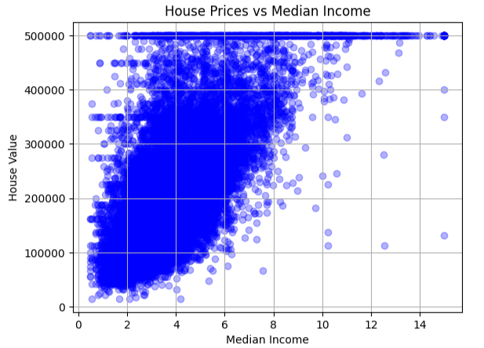

# California Housing Price Prediction

[](https://github.com/Yusyer174/house-prices-prediction-portfolio/actions/workflows/baseline.yml)

An educational scikit-learn regression baseline for historical California median housing values. The code, dataset and fixed split are included so the evaluation can be reproduced.

## Overview

The baseline uses linear regression, numeric median imputation and categorical one-hot encoding. Preprocessing is fitted on the training split only, using a scikit-learn pipeline. A fixed 80/20 train/test split (random state 42) makes the experiment reproducible.

## Run locally

Use Python 3.11 to match the recorded CI environment.

```bash
git clone https://github.com/Yusyer174/house-prices-prediction-portfolio.git
cd house-prices-prediction-portfolio
python -m pip install -r requirements.txt
python train.py
python -m unittest discover -s tests -v
```

To explore the data interactively, run `jupyter notebook notebook.ipynb` from the repository root.

## Results

The earlier four-feature exploratory model reported test R² = 0.5013. The improved pipeline uses additional housing features and handles missing values using preprocessing fitted on training data only.

**Historical holdout results** from the [recorded GitHub Actions run](https://github.com/Yusyer174/house-prices-prediction-portfolio/actions/runs/43220651075) on Python 3.11.

| Metric | Value |
| --- | ---: |
| Training rows | 16,512 |
| Test rows | 4,128 |
| R² | 0.616119 |
| MSE (USD²) | 5,030,408,039 |
| RMSE (USD) | 70,925.37 |
| MAE (USD) | 51,215.08 |

R² measures explained variance relative to a mean-prediction baseline; it is not classification accuracy. The results are from a single random split and do not establish geographic or temporal generalization.

## Geographic holdout experiment

Run `python evaluate_geographic.py` to reproduce a separate fixed-protocol experiment on the same historical dataset. Unlike the random baseline, this holds out entire one-degree latitude/longitude cells using seed 42. It compares the unchanged linear model with a training-mean dummy predictor and reports group overlap, row counts, metrics and the dataset hash. The 20% target applies to groups, not rows. Adjacent cells may still be correlated; this is exploratory, not a buffered or temporal validation. No result has been selected or tuned to improve the historical baseline.

Recorded [CI results](https://github.com/Yusyer174/house-prices-prediction-portfolio/actions/runs/46148453511) (Python 3.11.18, 2026-11-28, commit `195f01b`): 44 training cells / 14,410 rows; 11 held-out cells / 6,230 rows (30.18% of rows); zero overlapping cells.

| Model | R² | RMSE (USD) | MAE (USD) |
| --- | ---: | ---: | ---: |
| Linear regression | 0.618172 | 74,424.66 | 50,958.57 |
| Training-mean dummy | -0.021996 | 121,760.81 | 99,167.70 |

The linear model outperforms the dummy on the same held-out observations. The random-split and geographic metrics are not a controlled head-to-head model comparison because the evaluated rows and training sizes differ. These are exploratory historical results, not proof of geographic robustness. All 12 unit tests passed in the cited run.

See [experiment notes](docs/GEOGRAPHIC_EXPERIMENT.md) for the exact recorded protocol and interpretation.

## Grouped model comparison (development only)

Run `python compare_models.py` for five-fold geographic cross-validation of fixed linear regression, Random Forest and Gradient Boosting candidates, plus a training-mean dummy reference. Only the original geographic development partition is used. The primary comparison is pooled out-of-fold MAE on identical validation rows. The previous 11 held-out cells are not scored by the new models. See [comparison protocol](docs/MODEL_COMPARISON.md) for configurations, assumptions and interpretation. This is exploratory model selection, not an independent final test.

Recorded [CI results](https://github.com/Yusyer174/house-prices-prediction-portfolio/actions/runs/46148760695) (2026-11-28, source commit `4c1a1b9`): 14,410 development rows across 44 cells; 6,230 reserved rows across 11 cells; zero reserved rows scored by this comparison. All 17 tests passed.

| Model | Pooled R² | RMSE (USD) | MAE (USD) |
| --- | ---: | ---: | ---: |
| Random Forest | 0.648948 | 66,782.07 | 47,578.25 |
| Gradient Boosting | 0.601424 | 71,158.99 | 50,763.68 |
| Linear regression | 0.557791 | 74,952.79 | 53,081.09 |
| Training-mean dummy | -0.067184 | 116,437.75 | 92,548.50 |

Random Forest ranks first by the predefined pooled MAE criterion (10.37% lower than the linear candidate), and has the lowest MAE among the three candidates in each of the five folds. This is a development-CV result, not independent final-test evidence or a claim of real-world prediction accuracy. The historical random and geographic baseline metrics remain separate.

## Explore the data



The plot shows a relationship in the input data. The holdout metrics above measure model performance.

## Repository layout

- `train.py` — reproducible random-split training and evaluation
- `evaluate_geographic.py` — exploratory geographic holdout and dummy comparison
- `compare_models.py` — fixed-candidate grouped CV on development cells
- `notebook.ipynb` — interactive exploration and baseline evaluation
- `housing.csv` — local historical dataset
- `requirements.txt` — Python dependencies
- [`house_income_vs_value.png.png`](house_income_vs_value.png.png) — exploratory income versus housing value plot

## Data and limitations

The original notebook loaded the California housing CSV from the [Hands-On Machine Learning example dataset](https://github.com/ageron/handson-ml/blob/master/datasets/housing/housing.csv). The local dataset is retained for reproducibility. The repository's MIT license covers the project code, not any third-party dataset rights; consult the upstream source for dataset terms.

This is an educational historical-data experiment, not a current property valuation service. See the [model card](MODEL_CARD.md) for the dataset provenance, intended use, evaluation protocol, fairness considerations and limitations.

The training script checks required input columns and rejects missing, nonnumeric, or non-finite target values with a clear error before fitting. A custom CSV needs at least six rows for the fixed 20% holdout to contain two test observations and define R². This minimum is not a recommendation for statistically meaningful evaluation. Future improvements include buffered geographic validation, predefined nonlinear comparisons and error analysis across regions.

## Contributing

Focused contributions are welcome. Please read [CONTRIBUTING.md](CONTRIBUTING.md) and include tests and reproducible evidence when proposing changes to features or metrics.

## License

Project code: [MIT](LICENSE).
