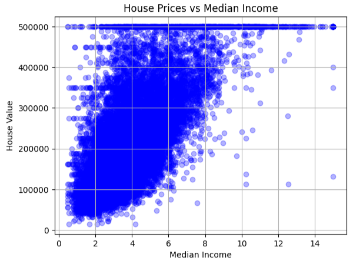

# California Housing Price Prediction

[](https://github.com/Yusyer174/house-prices-prediction-portfolio/actions/workflows/baseline.yml)

A machine-learning portfolio project exploring how housing and demographic features relate to median home values in California.

## Overview

The baseline uses linear regression, numeric median imputation and categorical one-hot encoding. Preprocessing is fitted on the training split only, using a scikit-learn pipeline. A fixed 80/20 train/test split (random state 42) makes the experiment reproducible.



## Run locally

Requires Python 3.11+.

```bash
python -m pip install -r requirements.txt
python train.py
```

To explore the data interactively, run `jupyter notebook notebook.ipynb` from the repository root.

## Results

The earlier four-feature exploratory model reported test R² = 0.5013. The improved pipeline uses additional housing features and handles missing values using preprocessing fitted on training data only.

**Verified baseline** ([GitHub Actions run](https://github.com/Yusyer174/house-prices-prediction-portfolio/actions/runs/43220651075), Python 3.11):

| Metric | Value |
| --- | ---: |
| Training rows | 16,512 |
| Test rows | 4,128 |
| R² | 0.616119 |
| MSE (USD²) | 5,030,408,039 |
| RMSE (USD) | 70,925.37 |
| MAE (USD) | 51,215.08 |

R² measures explained variance relative to a mean-prediction baseline; it is not classification accuracy. The results are from a single random split and do not establish geographic or temporal generalization.

Run `python train.py` to reproduce the baseline. Run `python -m unittest discover -s tests -v` to check the training pipeline.

## Repository layout

- `train.py` — reproducible training and evaluation
- `notebook.ipynb` — interactive exploration and baseline evaluation
- `housing.csv` — local historical dataset
- `requirements.txt` — Python dependencies
- `house_income_vs_value.png.png` — existing exploratory visualization

## Data and limitations

The original notebook loaded the California housing CSV from the [Hands-On Machine Learning example dataset](https://github.com/ageron/handson-ml/blob/master/datasets/housing/housing.csv). The local dataset is retained for reproducibility. The repository's MIT license covers the project code, not any third-party dataset rights; consult the upstream source for dataset terms.

This is an educational historical-data experiment, not a current property valuation service. Future improvements include geographic holdout validation, nonlinear baselines and error analysis across regions.

## License

Project code: [MIT](LICENSE).
